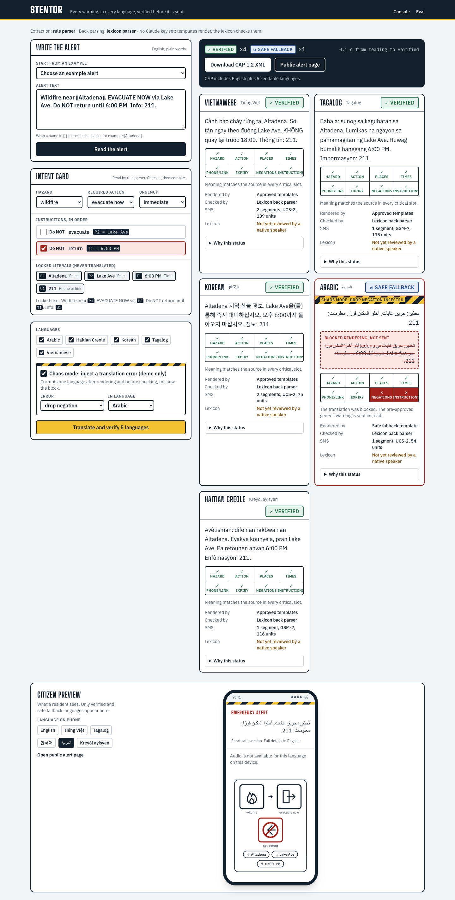

# STENTOR

**Every warning, in every language, verified before it is sent.**

An emergency manager writes one alert in plain English. STENTOR reads its meaning into a
structured *Alert Intent* (hazard, action, places, times, negations), translates it into
each community language, then **reads every translation back and compares it slot by slot**.
A language goes out only if its meaning matches. If it does not, that language is blocked and
gets a pre-approved generic safe warning instead of a wrong one.

Output: CAP 1.2 XML with one `<info>` block per language, SMS segment counts, audio, a
language independent pictogram card, and a public alert page.

**Live demo:** https://stentor-taupe.vercel.app (API: https://stentor-api.vercel.app/health).
The demo runs the deterministic path (approved templates + lexicon checks), so it needs no API key.



## Why

During the January 2025 Los Angeles fires, alerts went out only in English and Spanish
([Planetizen](https://www.planetizen.com/news/2025/02/134255-language-matters-addressing-communication-gaps-disaster-response)).
Machine translation exists, but agencies do not trust it for alerts: a dropped "not" or
"evacuate" softened to "prepare to evacuate" can kill. Nobody can proofread ten languages
under pressure. STENTOR makes the check mechanical. Sources are in [docs/PRD.md](docs/PRD.md).

## How it works

```
 English alert
     │
     ▼
 1 Read      intent.extract     Claude (or rule parser) -> AlertIntent
 2 Lock      lock.apply         Altadena -> ⟦P1⟧, 6:00 PM -> ⟦T1⟧, 211 -> ⟦U1⟧
 3 Render    render.route       approved templates > Adaption model > Claude
 4 Verify    verify             placeholders exactly once
                                action phrase present, no softer action
                                negation markers >= negated instructions
                                back parse with a DIFFERENT model (or lexicon)
                                slot diff: hazard, action, places, times, expiry,
                                negations, instructions, phone/link
 5 Decide    VERIFIED | REVIEW | BLOCKED -> FALLBACK (generic safe template)
 6 Restore   literals back, time format localized, RTL isolated
 7 Channels  CAP 1.2 XML · SMS · audio · pictogram · public page
 8 Audit     every decision and its reason stored in SQLite
```

| Status | Meaning | Sent? |
|---|---|---|
| ✓ Verified | All critical slots match | Yes |
| ! Review | Critical slots match; something non critical needs a person (for example the templates drop a word) | No, operator decides |
| ✕ Blocked | A critical slot differs | No |
| ↺ Safe fallback | Blocked, replaced by the verified generic warning for that hazard | Yes, the generic text |
| ✓ Approved | Was Review; a named operator checked it and approved it | Yes |
| ✕ Rejected | Was Review; the operator refused it and no safe fallback could be verified | No |

## Run it

```bash
cp .env.example .env                       # optional: ANTHROPIC_API_KEY, ADAPTION_API_KEY
cp apps/web/.env.example apps/web/.env.local

cd services/api && uv sync && uv run uvicorn stentor.main:app --reload --port 8000
cd apps/web && pnpm i && pnpm dev          # http://localhost:3000
```

Without any key, everything works deterministically: the rule parser reads the alert,
approved templates render it, and the lexicon back parser checks it. With
`ANTHROPIC_API_KEY`, Claude Opus 5.5 extracts and renders, and Claude Sonnet 5.5, a
different model, back parses. Claude calls use the server side refusal fallback
(`fallbacks: "default"`).

```bash
cd services/api
uv run pytest -q                                          # 227 tests
uv run python ../../eval/run_eval.py --offline            # eval, writes eval/results/latest.json
uv run python ../../eval/run_eval.py --force-model llm    # baseline LLM renderer (needs key, costs money)
pnpm --dir ../../apps/web gen:types                       # TS types from the OpenAPI schema
```

Languages: Vietnamese, Tagalog, Korean, Arabic (RTL), Haitian Creole (the PRD set), plus
Spanish and Turkish. 30 instruction types, 11 hazards, 9 actions.

Demo script: pick "Wildfire: evacuate via a route (demo)", **Read the alert**, turn on **Chaos mode**
(drop negation in Arabic), **Translate and verify**. Arabic turns to safe fallback and the
slot ledger shows Negations ✕. Then open the citizen preview and download the CAP file
([sample](docs/samples/demo.cap.xml)).

## Operator features

Beyond the demo path (full list with tests in [docs/FEATURES.md](docs/FEATURES.md)):

- **Review workflow:** a Review language is approved or rejected by a named operator on the
  alert page (`/alerts/[id]`); rejection sends the verified safe fallback.
- **Lifecycle:** write an update (`/?update=<id>`) or cancel an alert. Both are translated and
  verified like any alert and go out as CAP `Update` / `Cancel` with `<references>`.
- **CAP:** status Exercise/Test/Draft/System (Actual is refused), sender, polygon/circle/geocode
  area, and a built-in CAP 1.2 validator (`POST /validate/cap`).
- **Source check:** reading grade, long sentences, and intent contradictions before translating.
- **Back translation:** every language card shows what the translation says, in English.
- **Channels:** WEA 90 / WEA 360 / SMS fit per language, SSML for broadcast speech, JSON / text /
  CSV exports, audit log CSV, Atom feed, printable poster with QR code, pictogram SVG.
- **Language quality:** lexicon explorer, lexicon lint, native speaker sign-off (`/lexicon`),
  glossary of names never to translate (`/settings`).
- **Team data:** drafts, language presets, alert history with search (`/history`), stats (`/stats`),
  batch compile (`POST /batch`), duplicate send warning.
- **Platform:** optional operator token, rate limit, request id and `Server-Timing` headers,
  Prometheus `/metrics`, signed webhooks (HMAC SHA-256; chaos runs never sent).

| Variable | Default | Meaning |
|---|---|---|
| `STENTOR_OPERATOR_TOKEN` | empty | if set, every write needs `Authorization: Bearer <token>` |
| `STENTOR_RATE_LIMIT` | 120 | write requests per minute per client, 0 turns it off |
| `STENTOR_DUPLICATE_MINUTES` | 30 | warn when the same English text was compiled this recently |
| `API_PUBLIC_URL` | http://localhost:8000 | API address used in feed links |

## Eval

From `eval/results/latest.json`: 99 alerts (two suites) × 7 languages = 693 translations,
deterministic path, no API key.

| Metric | Clean suite (60 alerts) | Realistic suite (39 alerts) |
|---|---|---|
| Injected critical errors caught | 2296 / 2296 | 1386 / 1386 |
| Wrongly blocked clean translations | 0% | 0% (2 alerts are blocked on purpose, see below) |
| Verified / sent to Review / safe fallback | 93.3% / 6.7% / 0% | 66.7% / 28.2% / 5.1% |
| Status exactly as expected | 100% | 100% |
| Intent read correctly (hazard, action, negation count) | 60 / 60 | 39 / 39 |

The realistic suite holds messy wording ("EVACUATION ORDER for Topanga Canyon. Leave now.",
"Heat wave in Ankara: stay indoors between 11:00 and 16:00", "Stay out of damaged
buildings") and every bug found in an independent code review: "Evacuate now *from*
Altadena" read as a route, "St. Mary School" split in two, "3 p.m." swallowing the period, a
negation applied to the wrong clause, "1-800" numbers split, a time swap that went
undetected. Each is now a unit test.

Review is not failure: those alerts contain something the approved templates cannot say
("Call 911 *if safe*", "a room *without windows*") or STENTOR had to assume the action. They
are shown to the operator and not sent automatically.

Two realistic alerts are blocked on purpose. "Do not go to the hospital unless it is an
emergency" has a negation the approved templates cannot express, so leaving it out would
change the instruction: every language gets the pre-approved generic warning instead of a
Review item with the "not" silently missing.

**Read these numbers with their limits.** Without a key, the renderer and the back parser
share one lexicon, so a perfect catch rate is expected by construction: the eval shows the
checks fire on every known failure type, not that translation is good. The corruptions are
synthetic. The suites and the templates were written by the same team. The real test is
`--force-model llm` (and `adaption`) with a key: a model translates and a second model reads
back. Those numbers are not here because they have not been run.

## Limitations

- **Lexicons are LLM seeded and unreviewed.** Every language card says so. A native speaker
  should check the action phrases and negation markers (short lists in
  `services/api/stentor/lexicon/*.json`).
- Templates cover a fixed catalog of 30 instruction types. Anything outside it goes to a
  model renderer, or to Review when no key is set.
- Several places in one headline are rendered as a list ("I-5, Exit 132"); the relation
  between them ("on I-5 near Exit 132") is not modelled.
- A place written in lower case cannot be locked; the word is flagged and the alert goes to
  Review.
- CAP status is `Exercise`. STENTOR is not certified for production alerting and does not
  connect to IPAWS or carriers.
- Audio uses the browser's voices; many devices have none for Haitian Creole or Tagalog,
  and the UI says so.
- **The model path is not demo ready.** In our first real model run (Gemini free tier,
  10 Nov 2026) the Flash-Lite back parser mapped meaning into non canonical slots ("return
  until 6 PM" as "until cleared", a phone number as a quantity), so even the demo alert was
  blocked in three of four languages, and a 4 language compile took up to 4 minutes. It
  failed safe: nothing wrong was sent. The demo uses `STENTOR_LLM=off` until the back parser
  prompt is fixed.
- The hosted demo keeps SQLite in `/tmp` on Vercel, so alert history resets on a cold start.

## Layout

```
docs/                 PRD, PLAN, DOCS, PHASES, DEVPOST, screenshots, sample CAP
services/api/         FastAPI: intent/ lock/ render/ verify/ channels/ lexicon/
apps/web/             Next.js console (/), alert page (/alerts/[id]), history, stats, lexicons, settings,
                      public alert page (/a/[id]) and poster (/a/[id]/print), how it works, eval
eval/                 suites/clean.jsonl, suites/realistic.jsonl, run_eval.py, results/latest.json
data/adaption/        Invent-a-Dataset spec, seed_ht.jsonl, adaption_track.py
```

## Deploy

Both halves run on Vercel as two projects:

- **API** (`stentor-api`): repo root. `vercel.json` declares one Python service with
  entrypoint `app:app` (`app.py` imports `services/api`); `pyproject.toml` at the root lists
  its dependencies. Env: `STENTOR_LLM=off`, `STENTOR_DB_URL=sqlite:////tmp/stentor.db`,
  `CORS_ORIGINS=<web url>`, `PUBLIC_BASE_URL=<web url>`, `API_PUBLIC_URL=<api url>`.
- **Web** (`stentor`): root `apps/web`, build env `NEXT_PUBLIC_API_URL=<api url>`.

For a durable database, `render.yaml` still deploys the API as a Docker service
(`services/api/Dockerfile`, build context = repo root).

## License

MIT
